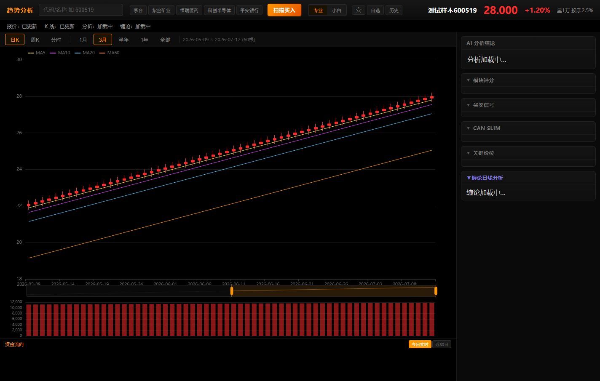
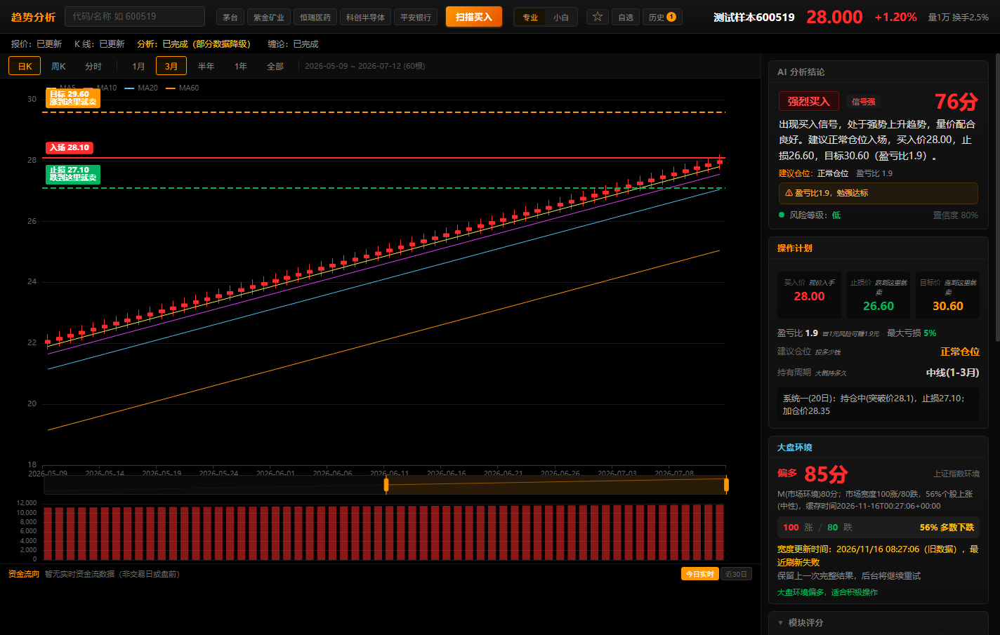

# 加载性能优化与验证记录

## 请求行为

- 市场宽度在服务启动后由独立后台线程立即刷新，此后每 120 秒刷新一次。每轮最多 30 秒，分页并发数为 8，与前台取数使用不同的线程池。
- 前台始终读取最近一次完整成功快照。过期、刷新中或刷新失败时保留旧值和原 `updated_at`；全部分页完成、总数一致且无重复股票后才替换成功结果。
- 刚启动、尚无成功快照时立即返回 `data: null`、`available: false`，分析标明市场宽度暂不可用，不阻塞等待。缓存保存在进程内，重启后重新建立。
- 个股 K 线、报价、资金流、大盘指数、K 线成交额/换手率补充并行获取。数据获取总预算 8 秒，非关键阶段预算 3 秒，排队时间包含在内。必需的 K 线失败时明确返回错误；非关键数据失败时分析继续并标明降级原因。
- 单次外部 HTTP 尝试预算 2 秒（连接最多 0.8 秒），重试共享阶段截止时间。到期的 API 不等待工作线程退出；已在进行的 HTTP 请求依靠网络超时结束。前台线程池最多 16 个线程、64 个运行及排队任务，防止慢上游导致无限堆积。
- 同参数的并发数据读取共享正在进行的抓取；HTTP Session 按线程隔离。基础价格缓存不会被成交额补充操作修改。
- 日/周线补充字段使用对应周期，避免周线误用单日成交额/换手率。

## 前端

报价和基础 K 线先发起独立请求，返回后立即显示。分析和缠论各自更新状态及面板，分时图与分时缠论同样独立加载。单个阶段失败不会清空其他阶段的成功结果。

切股或切换日/周线时取消旧加载会话、清理旧信号，忽略旧请求迟到的结果；报价和资金流的定时刷新也检查当前会话，并避免重叠轮询。浏览器每个请求最多等待 10 秒。

ECharts 继续使用 5.5.0，改为本站 `/vendor/echarts-5.5.0.min.js`，带版本文件设置一年缓存。来源、SHA-256、许可证和 NOTICE 在 `dashboard/vendor/` 中。Docker 的数据目录复制规则已更新，包含新增后台刷新与请求调度模块。

## 接口增量

原完整分析字段保持不变，`/api/analyze` 增加：

| 字段 | 含义 |
| --- | --- |
| `breadth_status.available` | 是否存在成功快照 |
| `breadth_status.updated_at` | 最近成功获取完整快照的时间，带时区 ISO 8601；不等于交易所行情时间 |
| `breadth_status.age_seconds` | 当前快照年龄 |
| `breadth_status.stale` | 超过刷新周期、最近刷新失败或尚无成功快照 |
| `breadth_status.refreshing` | 后台正在刷新 |
| `breadth_status.last_attempt_at` | 最近一次刷新开始时间 |
| `breadth_status.last_error` | 最近刷新失败原因；成功后清空 |
| `degraded` | 阶段名到失败/降级原因的映射 |
| `timings_ms` | 每个取数阶段、宽度缓存读取、分析运算与总耗时 |

新增 `/api/market_breadth` 直接返回上述状态及 `data`（宽度计数或 `null`）。`/api/kline?symbol=600000&count=250&basic=1` 返回基础 K 线，跳过补充字段，供首屏使用；默认请求仍补充成交额和换手率。缠论只依赖基础 OHLCV。

耗时日志使用 `request_id` 关联，主要记录为 `http_fetch`、`data_cache`、`data_stage`、`fetch_stage`、`analysis_done` 和 `api_done`；浏览器控制台记录 `load_stage`。日志不输出完整行情响应。

## 2026-11-16 实测

同一台 Windows 机器、相同现有行情源、`600000`、日线、250 根取数、调用完整分析处理函数；冷缓存清空个股数据缓存，热缓存紧接冷请求。以下是服务端处理耗时，不包含浏览器下载和渲染。

| 状态 | 冷缓存 | 紧接的热缓存 | 数据完整性 |
| --- | ---: | ---: | --- |
| 修改前 | 2512.3 ms | 0.5 ms | 返回 120 根展示 K 线、5929 只市场宽度 |
| 修改后第 1 轮 | 586.9 ms | 1.2 ms | 同样条数，无降级 |
| 修改后第 2 轮 | 558.3 ms | 1.2 ms | 同样条数，无降级 |
| 修改后第 3 轮 | 100.1 ms | 1.5 ms | 同样条数，无降级 |

修改后第 1 轮比修改前这一次样本少约 76.6%。外部源响应会波动，第 2/3 轮复用进程中的网络连接，因此这不是稳定延迟承诺；本次修改前没有复现约 15 秒。

修改后的市场宽度先在请求之外成功刷新，再测个股冷缓存，确保性能数字没有通过省略市场数据取得。这次全量刷新耗时 **12337.4 ms**，出现主数据源断连并切换备用源，最终获取完整 5929 只数据。该耗时不再计入用户分析请求；启动期间没有成功快照的响应由测试单独覆盖。

复测命令（只输出计时及条数，不保存行情）：

```powershell
py -3 -X utf8 -B tools/benchmark_requests.py --symbol 600000 --period day --runs 3
```

可用 `--endpoint kline`、`--endpoint quote` 或 `--endpoint chanlun_daily` 单独测量对应阶段。

## 验证

- Python `compileall` 通过；17 项 `unittest` 通过，包含实际本地 HTTP 慢响应的预算检查、并发合并、完整分页、失败保留旧快照及分析降级。
- 3 项 Node 测试通过：基础数据不等慢分析、取消后忽略迟到结果、超时可见。页面内联 JavaScript 语法检查通过。
- 本机 Chrome 使用确定性模拟行情验证：报价和 K 线已显示时分析/缠论仍显示“加载中”；随后独立完成。快速切换股票后保留最新股票，页面无 JavaScript 异常，ECharts 只请求本站文件。
- 本地 `/api/health` 返回 `ok`，市场宽度接口显示成功时间和旧数据状态，静态 ECharts 返回 200 及版本缓存头。
- `git diff --check` 通过。截图采用生成的测试样本，不是真实行情。

验证命令：

```powershell
py -3 -m compileall -q app.py analysis data
py -3 -B -m unittest discover -s tests -p "test_*.py"
node --test tests/test_request_loader.cjs
```




